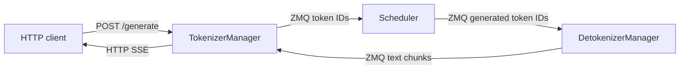

# 2. 동시성과 SLO

## 실습에서 확인한 값

긴 요청 A가 실행 중일 때 짧은 B와 C가 합류해 먼저 끝났습니다. E는 A가 거의 끝날 무렵 도착해 나중에 끝났습니다. 타임라인에서 A가 끝난 뒤 첫 토큰을 받은 요청과 A의 실행 중 첫 토큰을 받은 요청을 구분할 수 있습니다. 이 실행에서 A는 0.00→1.20초, B는 0.30→0.46초, E는 1.20→1.36초였습니다.

첫 요청은 HTTP/TokenizerManager에서 토큰화되고, Scheduler가 prefill batch에 넣습니다. 토큰이 생성되면 DetokenizerManager를 거쳐 스트림으로 돌아옵니다. 첫 토큰까지의 경로가 TTFT에 포함되고, 이후의 decode·detokenize·전송 차이가 ITL에 나타납니다. [SGLang 코드 지도](../code_map.md)

유휴 상태에서 `py-spy dump`를 한 번 찍으면 `event_loop_overlap` 아래에 `ingest_requests`, `recv_requests`, ZMQ의 `recv_pyobj`가 보입니다. 이 스택은 요청 수신 경로를 보여 줍니다. GPU가 얼마나 바빴는지는 부하가 있는 동안 [Session 6](session06.md)의 trace에서 읽습니다. A가 끝나기 전에 B와 C의 첫 토큰이 나왔는지는 타이밍 JSON의 `first_token_s < A.finish_s`로 확인하고, 같은 decode step에 합류한 요청 수는 서버 로그의 `#running-req`로 확인합니다. [유휴 스택](data/s02_scheduler_stack.txt) · [요청 타이밍](data/s02_staggered.json)

입력 2,000인 요청 하나를 보낸 구간에서는 `Prefill batch`에 `#new-seq: 1`, `#new-token: 2000`, `#cached-token: 0`이 나왔습니다. 직후 `Decode batch`의 `#running-req`는 1이었습니다. `#token`은 이 batch가 KV에 보관한 토큰 수를 나타내므로 출력 토큰은 클라이언트의 `completion_tokens`에서 확인합니다. 여러 요청이 겹치는 실험에서는 이 로그만으로 개별 요청의 TTFT를 뽑기 어려우므로 클라이언트 시각도 저장합니다. [단일 요청 로그](data/s02_single_request_log.txt)

## 과제 예시

입력 외에는 모델, 출력 256, 동시성 표, 서버 설정을 유지했습니다. 각 점의 완료 요청 수도 확인했습니다.

| 입력 (token) | SLO를 만족한 최대 측정 동시성 | 그 점의 output tok/s | p95 TTFT (ms) | p95 ITL (ms) |
|---:|---:|---:|---:|---:|
| 512 | 128 | 16,029.5 | 407.3 | 6.9 |
| 2,048 | 32 | 4,635.5 | 414.0 | 5.4 |

팀장에게는 이렇게 답할 수 있습니다. “이 H100에서 입력 512의 동시성 128과 입력 2,048의 동시성 32가 두 기준을 모두 지켰습니다. 512 입력은 가장 높은 시험점까지 통과했으므로 한계를 더 좁히려면 더 높은 구간을 재야 합니다. 2,048 입력의 동시성 64에서는 p95 TTFT가 약 814 ms로 실패했고 ITL은 기준 안이었습니다. 여기서 보고한 동시성은 HTTP 요청 수이고, 사용자 수로 바꾸려면 사용자당 요청 패턴이 필요합니다.”

2,048 입력에서는 입력당 prefill 계산과 KV 슬롯이 함께 늘었습니다. 같은 서버의 실험 구간을 나누고 `common/logparse.py`로 요약하니 `token_usage_max`가 0.17→0.53, `queue_req_max`가 18→67이었습니다. pool에 여유가 남은 동안에도 대기가 생겼으므로 KV 고갈 하나로 설명하기 어렵습니다. 동시성 64·128에서 긴 prefill과 대기가 언제 겹쳤는지 로그를 읽으면 다음 비교점을 잡을 수 있습니다. [스케줄러 로그 집계](data/s02_scheduler.csv)

[512 CSV](data/s02_base.csv) · [2048 CSV](data/s02_in2k.csv)

### 과제 C 요청 경로 그리기

`_tokenize_one_request`에서 입력이 ID로 바뀌고, `get_next_batch_to_run`에서 다음 GPU batch를 정하고, `handle_batch_token_id_out`에서 출력 ID를 텍스트로 바꿉니다. 일반 decode 서빙에서 새 prefill batch를 만들 수 있으면 먼저 실행하고, 만들 수 없거나 설정된 간격 때문에 미루면 실행 중인 decode batch를 진행합니다. `POST`부터 첫 SSE 토큰까지 한 바퀴를 TTFT로 표시합니다. 이후 SSE 토큰 사이를 ITL로 표시합니다. [코드 지도](../code_map.md) · [v0.5.23 스케줄러](https://github.com/sgl-project/sglang/blob/v0.5.23/python/sglang/srt/managers/scheduler.py#L3694-L3725)

## 재현

[실습 2–4](../../session02_architecture_batching/lab.md)와 [과제 A2](../../session02_architecture_batching/assignment.md)의 길이와 동시성 표를 사용했습니다. 용량은 `find_capacity.py --slo p95_ttft_ms=500 --slo p95_itl_ms=50`으로 정했습니다.

## 어떤 값으로 결론을 내렸나

1. [벤치마크 CSV](data/s02_base.csv)의 `completed`를 확인하고, 입력 길이마다 `max_concurrency`가 같은 점을 맞춥니다. 예를 들어 동시성 128은 두 실행에서 각각 512개를 완료했습니다.
2. `max_concurrency`를 조건, `output_throughput`을 처리량, `p95_ttft_ms`와 `p95_itl_ms`를 통과 기준으로 사용합니다. 표에서 기준을 모두 만족한 가장 오른쪽 점에 표시합니다. p95 TTFT는 요청별 지연, p95 ITL은 관찰된 토큰 간격을 집계합니다.
3. 요청 합류는 그림의 `arrive_s`, `first_token_s`, `finish_s`를 봅니다. 용량의 원인을 더 자세히 읽을 때는 서버 로그에서 `Prefill batch`의 `#new-token`과 `#queue-req`, `Decode batch`의 `#running-req`를 시간 순으로 확인합니다. 같은 시간대에 queue가 늘고 pool 사용량이 낮다면 다음 비교에서 prefill 길이만 바꿔 봅니다.

## 선택 실습에서 읽을 것

도착률 25→75 req/s에서 실제 완료율은 23.6→49.7 req/s, 최대 동시 요청은 63→189였습니다. p95 TTFT는 18.9→28.6 ms로 움직였고 p95 ITL은 6.3→17.6 ms였습니다. 이 실행에선 TTFT 하나만 보면 부하의 변화를 작게 읽게 됩니다. `request_rate`와 `request_throughput`, `max_concurrent_requests`, TTFT·ITL·E2E를 함께 보고, 지속적으로 밀리는지 보려면 같은 도착률에서 관측 시간을 늘립니다. [open-loop CSV](data/s02_rate.csv)

과제 A3을 더할 때는 입력 512와 동시성 1·8·32·64를 맞추고, 출력 256·1,024의 `request_throughput`, `output_throughput`, `p95_ttft_ms`와 원본 JSONL의 `mean_e2e_latency_ms`를 읽습니다. 요청이 오래 머물면 평균 처리 중 요청 수가 같을 때 완료율은 낮아질 수 있습니다. 출력이 길어져 요청당 토큰은 늘어나므로 tok/s도 같은 비율로 움직인다고 가정하지 않습니다. Little's law의 `L = λW`에는 같은 정상 상태 구간의 평균 요청 수·완료율·평균 E2E를 씁니다. A3의 측정값은 이 예시에 없습니다.
